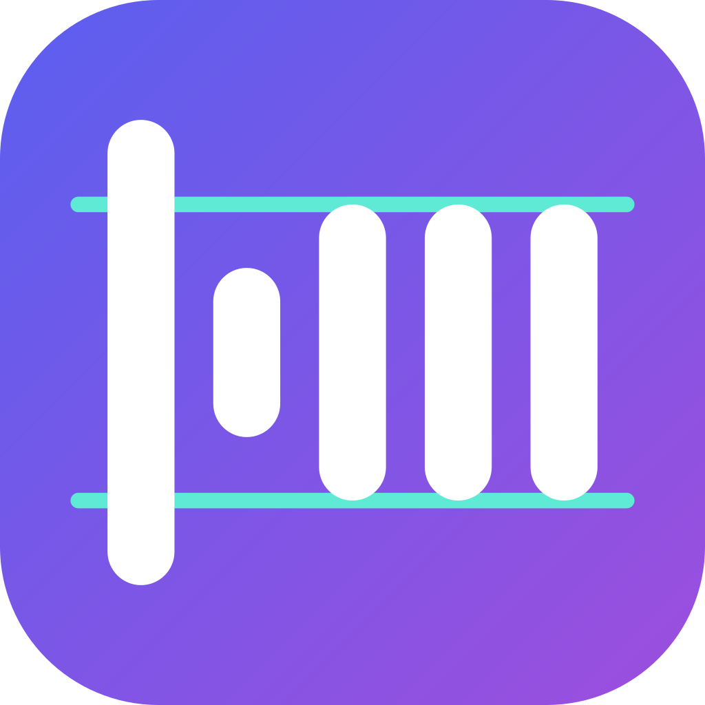
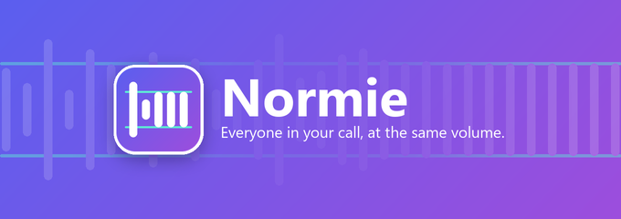

<p align="center">
  
</p>

<h1 align="center">Normie</h1>

<p align="center">
  Voice normalizer for Discord<br>
  <a href="https://github.com/FerrLab/normie/releases/latest"><b>Download normie.exe</b></a>
</p>

Normie evens out **what you hear** in a Discord call: people who are too loud get turned
down, people who are too quiet get turned up — automatically, while the call is going on.

- It only affects **you**. Normie uses the same control as
  *right-click a user → User Volume* in your Discord.
- Your friends don't install anything and don't notice anything.
- When you close Normie, Discord restores the volumes you had before.
- Everything runs on your computer — see [Privacy](#privacy).

## Install

**Option 1 — `.exe` (no Python needed):** download `normie.exe` from the
[latest release](https://github.com/FerrLab/normie/releases/latest) and run it.
Windows SmartScreen may warn that the app isn't signed → *More info* → *Run anyway*.

**Option 2 — Python 3.10+:** download `normie.py` from the release (or clone this repo)
and run:

```powershell
pip install -r requirements.txt
```

```powershell
python discord_normalizer.py
```

## Usage

1. Click **Connect**.
2. The first time, Discord shows an authorization request → **Authorize**.
   After that, Normie reconnects on its own whenever it starts.
   If Discord refuses your account, Normie opens a short guide to use your own Discord
   app instead — see [Normie's shared app vs. your own](#normies-shared-app-vs-your-own).
3. Join a voice call. Each person shows up on a card:
   - **bar**: how loud you hear them, with a white mark at the target
     (green = on target, yellow = quiet, red = loud);
   - **"mic reaches …"**: their level before your volume is applied;
   - their **volume** in your Discord, with ▲/▼ right after an adjustment;
   - **AUTO / LOCKED**: click to stop adjusting that person (e.g. a music bot).
4. **Tray:** minimizing hides the window in the icon near the clock while Normie keeps
   working. Click the icon to open it; right-click to toggle normalization or quit.
   Closing the window (X) quits Normie.

### Settings

| Control | What it does |
|---|---|
| Auto-normalize | Turns adjustments on/off (measuring continues). |
| Target level | Where everyone gets pulled to. Set it by ear. |
| Advanced settings → Speed | How much of the error is corrected per ~2 s of speech. |
| Advanced settings → Allowed volume | Limits for the volume (Discord accepts 0–200%). |
| Advanced settings → Monitored output | **Same as Discord (automatic)** by default: captures the device Discord plays on and follows it when you change it in Discord. You can also pick a device by hand. |
| Advanced settings → Discord app | Normie's shared app by default. **Use my own app…** walks you through creating your own Discord app (about 2 minutes). |
| Advanced settings → Minimizing hides Normie in the tray | Turn off to minimize normally. |
| Activity | History of adjustments and errors. |

## How it works

```
 Discord (local RPC) ──GET_VOICE_SETTINGS──► which output device is Discord using?
                                        │  capture that same device (and follow changes)
                                        ▼
 your sound card ──loopback──►  measures the level (dBFS) every 100 ms
                                        │
 Discord (local RPC) ──SPEAKING_START──► who is talking right now?
                                        │  only 1 friend talking → the level is theirs
                                        ▼
                         after ~2 s of that person's speech:
                         compute_new_volume() picks the new volume
                                        │
 Discord ◄──SET_USER_VOICE_SETTINGS─────┘  (that friend's volume slider)
```

Normie logs in with the Discord application whose ID is in `CLIENT_ID`, at the top of
the script, or with your own app if you set one up. Either way it's a **Public Client**,
so authorization uses PKCE: every login creates a one-time random code instead of an app
password, and there is no client secret.

## Privacy

All processing happens on your computer:

- **Audio is never recorded.** Every 100 ms, the sound on your output device is reduced
  to a single loudness number, kept only in memory.
- **The only internet request** goes to `discord.com/api/oauth2/token`, to get or
  refresh your login token. Talking to Discord itself goes through a local pipe on your
  computer.
- **No** analytics, telemetry, crash reports, update checks or third-party services.
  This was verified by auditing the code and its dependencies and by monitoring the
  app's connections while it ran connected to Discord.

Full details in the [Privacy Policy](PRIVACY.md).

## Normie's shared app vs. your own

Discord only lets an app control voice settings (RPC) for everyone after it approves the
app. Until then:

- **Normie's shared app** (the default) only works for accounts on its **App Testers**
  list, up to 50 people. Being on the app's team isn't enough. Anyone else gets
  `invalid_scope` when they click **Authorize**. The app's developer adds testers under
  *Developer Portal → Normie → App Testers*.
- **Your own app** works for you right away, because an app's owner needs no list. In
  Normie, open **Advanced settings → Discord app → Use my own app…** (it also opens by
  itself when Discord refuses the shared app) and follow the three steps:
  1. create an app at <https://discord.com/developers/applications> under your
     **personal** account — apps owned by a team need testers too;
  2. under **OAuth2**, add the redirect `http://localhost`, turn on **Public Client** and
     save;
  3. paste the **Application ID** from *General Information*. Normie checks it with your
     Discord app before saving it.

  **Go back to Normie's shared app**, in the same window, undoes it.

If you publish your own fork, replace `CLIENT_ID` at the top of the script.

## Limitations

- **Other sounds on the same output skew the measurement.** Normie measures everything
  that plays on Discord's output device, so loud games or music mixed with voices distort
  the reading. If you can, give Discord its own output (Discord → Settings → Voice & Video
  → Output Device); Normie follows it automatically.
- **It only measures when one person speaks alone.** When people talk over each other,
  nothing is measured and volumes stay where they are.
- **200% is Discord's ceiling (about +6 dB).** Someone with a very quiet mic may not
  reach the target.
- **One app at a time.** Discord lets only one program control voice settings over RPC
  at a time, so Stream Deck/Touch Portal plugins for Discord may conflict.
- Windows only (it uses WASAPI and the Discord desktop app's IPC pipe).

## Configuration file

`discord_normalizer_config.json` (created next to the script or the `.exe`) stores your
settings and your Discord **access token** in plain text. Don't share it; it's already in
`.gitignore`.

## Brand assets

Voice bars: one too loud, one too quiet and three leveled inside the target band —
exactly what Normie does to your call.

<p align="center"></p>

| File | Use |
|---|---|
| [`assets/normie.svg`](assets/normie.svg) | Vector logo, for the web and documents. |
| [`assets/normie.png`](assets/normie.png) | 1024 px with rounded corners (app icon). |
| [`assets/normie-discord.png`](assets/normie-discord.png) | 1024 px, full square with margin for Discord's circular crop (app icon in the Developer Portal or server icon). |
| [`assets/normie-banner.png`](assets/normie-banner.png) | 680×240 banner for Discord; keeps the bottom-left free for the avatar. |
| [`assets/normie-social.png`](assets/normie-social.png) | 1280×640 social share image: GitHub's social preview (*Settings → General → Social preview*) and link cards elsewhere. |

The logo's geometry lives in `LOGO`, at the top of the script's GUI section — the window,
tray and `.exe` icons are drawn from it.

## Releasing a version

Go to **Actions → Release → Run workflow** and enter the version (e.g. `1.0.0`). On a
Windows runner, the workflow:

1. validates the version and checks that the tag `v1.0.0` doesn't exist yet;
2. writes the version into the script (`APP_VERSION`) and checks that it imports;
3. builds the icon and `normie.exe` with PyInstaller (`--onefile --windowed`);
4. creates the `v1.0.0` release with `normie.exe`, `normie.py`, `requirements.txt` and
   `SHA256SUMS.txt`, with notes generated from the commits.

## Legal

- [Terms of Service](TERMS.md)
- [Privacy Policy](PRIVACY.md)
- [MIT License](LICENSE)

Normie is an independent project and is not affiliated with, endorsed by or sponsored by
Discord Inc.
